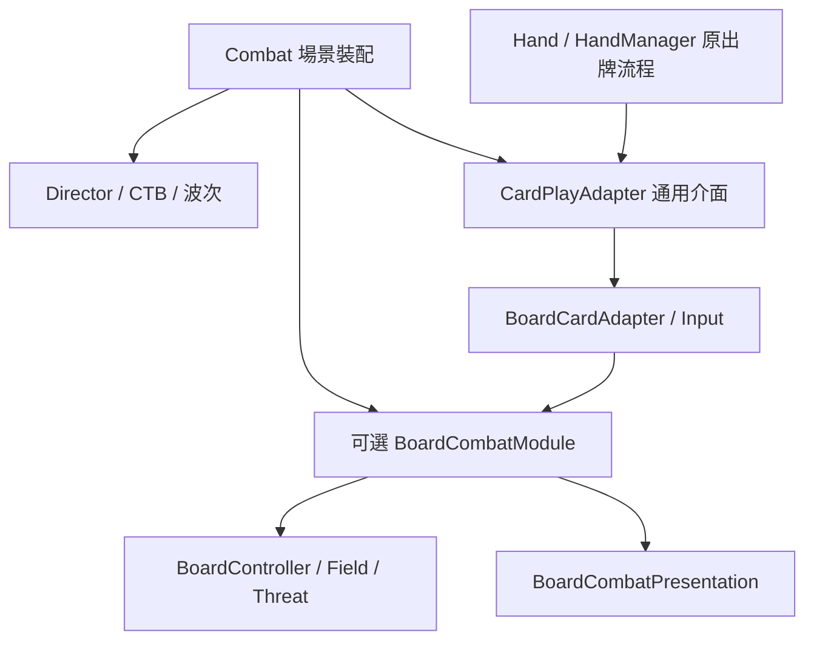

# 棋盤是可選的 Combat 模組

[設計分析入口](README.md)｜[工作流](../../../wf/workflows/game-dev/mechanics/board-module.md)｜[雙盤 A 契約](dual-board/README.md)｜[驗收矩陣](board-module-verification.json)

2026-10-20 核實。[證據](../evidence/2026-10-20/board-module/README.md) 對應矩陣 8 列：scope 是需求，test_file／assertion_ids 是測例，status／run_path 是實證。

## 裝配與責任

[Combat.gd](../../../game/scripts/ui/Combat.gd) 是場景裝配點。其 `board_module_enabled` 與 [CombatRulesData](../../../game/data/readonly/CombatRulesData.gd) 的 `board_enabled` 都為 true，才建立 [BoardCombatModule](../../../game/scripts/combat/board/BoardCombatModule.gd) child。兩個旗標預設為 true，以保留已有棋盤內容。關閉任一旗標稱為 NONE：沒有棋盤模組實例，也不建立 BoardController、FieldController 或 ThreatPreview；SINGLE 仍是一個真正存在的共用棋盤，不能拿它冒充 NONE。

[CombatDirector](../../../game/scripts/combat/CombatDirector.gd) 保留 CTB、行動等待、generation、角色控制器、波次與勝敗流程，獨立保存 Encounter。它在戰鬥開始時讀取場景已裝配的模組並呼叫 setup，本身不建立棋盤資源。`board_controller`、`battlefield`、`field_controller`、`board` 與 `threat_preview` 是相容查詢入口，未掛載時回 null。

模組擁有 BoardController、ThreatPreview 和 [BoardCombatPresentation](../../../game/scripts/ui/BoardCombatPresentation.gd)，處理站格、移動額度、場域反應與到期、出牌後 undo 失效與移動限制。核心負責輸入時機，模組判定空間操作是否合法。這是固定的可選元件，不是動態 plugin registry。

[CombatActionPhases](../../../game/scripts/combat/CombatActionPhases.gd) 只在模組存在時通知 `on_action_reset`、`on_action_started`。普通狀態觸發、能量、抽牌、棄牌、格擋與既有回合訊號仍由原流程執行。時間軸推進也始終處理普通 tick 狀態，場域時鐘則委派模組。

## 普通戰鬥與棋盤戰鬥

[UnitSpawner](../../../game/scripts/combat/UnitSpawner.gd) 在 NONE 仍建立真正敵人：首波沿用事件的自動排版或指定顯示位置與出生延遲，後續波次照時間表加入 CTB。它不要求占格成功，也不以假座標或隱藏棋盤維持功能。掛載模式找不到指定盤或合法落格時仍按原來的拒絕／重試規則處理，不能把缺少 membership 視作 NONE。

[EnemyIntentController](../../../game/scripts/combat/controllers/EnemyIntentController.gd) 在掛載模式委派 [BoardEnemyIntent](../../../game/scripts/combat/board/BoardEnemyIntent.gd)，保留移動、射程與命中規劃。NONE 執行普通攻擊、格擋、音效及自訂 actions；預設目標為存活主角，SELF 指向自己。含盤面自訂效果的整份意圖由能力檢查拒絕，不先執行普通傷害再跳過位移。NONE 不重解 NEAREST、FARTHEST 等幾何目標規則。

[Player](../../../game/scripts/combatants/Player.gd) 有 ThreatPreview 時使用盤面命中與時序預覽；NONE 則加總存活敵人的普通意圖，排除 SELF 與能力檢查拒絕項。後者不是 CTB 時窗預測。

## 出牌接點與費用原義

[CardPlayAdapter](../../../game/scripts/combat/CardPlayAdapter.gd) 是普通出牌策略；場景提供 [BoardCardAdapter](../../../game/scripts/combat/board/BoardCardAdapter.gd) 時，才加入選格、範圍、盤身份與請求生命週期檢查。棋盤輸入綁定放在獨立 BoardCardInput／呈現層，Hand 不自行建立棋盤。關閉棋盤後保留能力 guard，讓盤面專用牌回報 `board_module_required`，普通牌仍能走正常出牌流程。

[HandManager](../../../game/autoload/HandManager.gd) 保有扣費、保留能量、出隊與退費責任。adapter 在入隊扣費前驗證，出隊再次驗證；其同步 hooks 不自行扣費、退費、抽牌或排 actions。出隊拒絕沿既有 refundable energy 流程回復保留費用。`resolve_play` 只提供執行資料；普通、免費、重複出牌與牌堆去向由 [boardless_card_cases](../../../tests/boardless_card_cases.gd) 對原出牌路徑回歸。

棋盤 request 核對模組 instance、模組 generation 與 Director generation。模組每次 clear 遞增自己的 generation，拒絕同一 Node 重用後的舊請求；普通 CTB generation 與非棋盤工作保留。這個上下文屬於請求，不寫入永久卡牌內容。BaseAction 的範圍／場域目標枚舉保留數值相容，幾何解析透過 Director 委派 [BoardActionTargets](../../../game/scripts/combat/board/BoardActionTargets.gd)。

## 內容與相容

新內容的棋盤選項放在既有 `card_values.board` 字典，使用 `range`／`shape`／`target_faction`；[BoardCardOptions](../../../game/scripts/combat/board/BoardCardOptions.gd) 讀取後交空間查詢。舊 CardData 的同名 `card_*` 欄位仍可反序列化，僅在沒有具名選項時回退；`card_move_distance` 只由 adapter 相容轉譯，示範新牌使用顯式 MoveUnit。普通打擊與格擋不帶 board 選項，保持原選敵／自動出牌。

兩個既有複製出牌 interceptor 透過 `CardPlayRequest.copy_selection_context_from` 複製選取：字典／陣列容器獨立，但 unit 身分相同，模組 lifetime 原樣繼承。`card_values` 仍由原工廠重新取當時牌值，沒有改成舊快照。這些薄相容接點仍存在；本次分離責任並不宣稱整個框架零耦合。

## 停止與重建

模組 clear 先停止呈現輸入，再清除自己棋盤的占格與角色 anchor，最後清 BoardController。FieldController.clear 會更新 generation 並關閉 active，使舊場域反應不能續寫新戰鬥。清理只碰本模組的盤，不掃除其他場景 registry。下一場 setup 會先清舊資源，再建立新一場的盤、場域及呈現。

主角死亡可能早於死亡動畫完成。Director 的死亡停止使用 preserve presentation：立刻停輸入、移動與場域，但保留已提交的死亡目的位置；直到 combat ended、run ended、下一次 setup 或 scene exit 才恢復／釋放呈現。

Director 的模組 getter 排除 freed、queued for deletion 與已離開場景樹的實例；模組 exit 依 instance 身份解除引用，不清除後來裝配的新實例。[dual_board_adapter_cases](../../../tests/dual_board_adapter_cases.gd) 經公開出牌佇列驗同 Node clear/setup、queue_free 後續行普通 CTB、換新模組後拒絕舊請求，以及保留費用只退一次、普通防禦牌仍執行。這涵蓋明確的卸載與重掛邊界，不代表提供任意元件的熱切換平台。

## 回歸範圍與限制

[boardless_flow](../../../tests/boardless_flow.gd) 與 [campaign](../../../tests/boardless_campaign.gd) 從正常選角、教學、地圖入口驗普通出牌、敵人反擊、勝利獎勵、跨程序 Continue 與死亡流程，並檢查規則旗標及場景旗標各自關閉時沒有盤面資源或 UI。[晚波回歸](../../../tests/boardless_wave_cases.gd) 用戰前宣告的兩波 fixture，驗延遲出生、registry 身份、CTB 行動與末波勝利；[意圖回歸](../../../tests/boardless_intent_cases.gd) 驗 SELF、普通效果順序及巢狀盤面效果整份拒絕。

掛載模式仍使用 Board、DualBoard、Field、Wave 與資源生命週期回歸；複製出牌的容器隔離與 lifetime 繼承另見 [dual_board_duplicate_cases](../../../tests/dual_board_duplicate_cases.gd)。這些是固定情境的功能證據，不是平衡統計。GUI 畫面、音訊及人工操作感受尚未驗證；本輪維持僅檔案操作與隔離 headless 的邊界。
