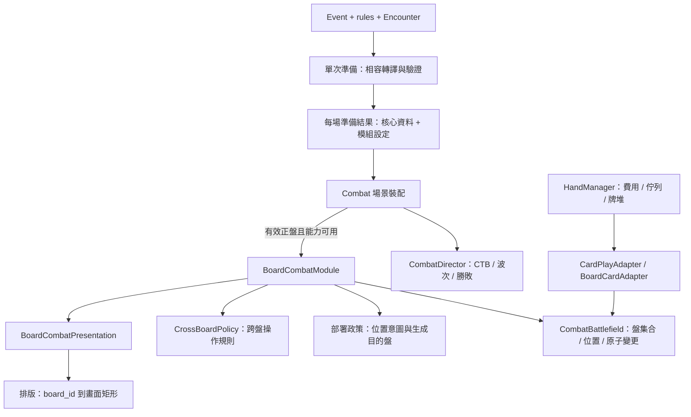

# 每場 0~N 盤：解耦架構草案

[棋盤模組現況](../board-module/README.md)｜[現況調查](../../notes/investigations/2026-10-21-multi-board-feasibility.md)｜[遷移計畫](../../plans/multi-board/README.md)

狀態：2026-10-21 架構先行規劃；其後遷移 A 已完成每場準備與資料所有權，B／C 尚未實作。使用者確認目標為每場 0~N 盤，要求乾淨解耦，不先定死部署玩法。本草案不把調查 M1、陣營主場、盤數上限或排版提案升為產品決策。調查基準為 `7eba093`，A 實作基準為 `2b3dec8`；現況與證據見 [準備分析](../../../analysis/slay-the-robot/architecture/08_combat_preparation.md)。

## 方案

用一份每場準備結果連接內容與裝配；棋盤模組內再分離盤集合、部署政策與呈現排版。盤數由盤定義集合導出，0 是有效空集合。普通戰鬥的 CTB、費用、牌堆與結算持續由原 owner 管理。

箭頭代表資料使用或組裝依賴，不代表所有責任都要新建類別。沿用既有 CombatModule 單一可選元件，不新增通用 registry、服務容器、事件匯流排或任意插件載入系統。純轉譯／排版先用小型純函式；只有確實有獨立狀態或第二種實作時才增加介面。

## 結構邊界

**盤定義與身分**只回答有哪些盤、大小、地形與穩定 ID。ID 不取自陣營、顯示順序或陣列 index。新集合可用任意不重複 ID，`party`／`enemy`／`shared` 只保留為舊內容相容值。每場開始後定義保持不變；本輪不引入戰中動態增刪盤。

**跨盤政策**回答某種操作能不能跨這兩盤、如何計算範圍。現有 A 保持原義：跨盤不計距離、局部形狀在目標盤展開、方向型跨盤拒絕。畫面距離與盤排列不是遊戲拓樸；本輪不新增盤間距離／鄰接圖，只讓將來替換政策時不必改盤集合與 UI。

**部署政策**回答單位初次加入哪盤、起點與候選格。它不創建敵人、不發 CTB 行動，也不改 faction；幾何層驗證占格是否合法，UnitSpawner 保留延遲／重試／略過與 admission 的責任。主角、隊友、敵人、召喚是否上盤屬政策／內容，不寫死在 Battlefield。舊模式以相容政策保持目前行為，新內容可先明確指定目的盤，不需預先選一個永久 home 模型。

**呈現排版**只將 ID 對應到 viewport 矩形／縮放／可見性，不能改盤大小、unit anchor、陣營或射程。視圖順序有獨立資料；重排視圖後既有選取與單位仍指向原 ID。盤多時選縮放、捲動或分頁是後續呈現方案，不把目前雙槽可讀性轉成戰鬥資料的 3／4 盤硬限制。

細部資料與現有檔案的遷移責任見 [資料與介面](contracts.md)；開始、失敗與退出見 [生命週期](lifecycle.md)。

## 取捨與未定範圍

不繼續擴充 `BOARD_MODES` 去列舉三盤、四盤或多陣營盤：這會使盤數與玩法語意綁在一起。舊 enum 只留在輸入轉譯邊界；runtime 直接使用正規化集合。也不把空 `encounter_boards` 改成 0，因為現有 `{}` 表示沿用預設，會破壞舊內容。

不把全功能拓樸或策略系統一次建完。先抽出現有相容行為、證明依賴方向與 0 路徑，再接任意明確盤集合。效能資源保護與 UI 可讀性分開衡量；若需限制，依格數、單位數或量測成本明列可配置邊界與錯誤，不隱藏截斷或自行把 N 定為小常數。

此規劃不決定主角初始盤、敵我各幾盤、隊友是否入盤、跨盤距離或最終排版。這些答案後續落在內容與具體政策；目前足以先規劃與重整責任，不要求使用者先回答玩法。外部 JSON 欄位名稱與相容版本也尚未定稿；實作前依 [契約](contracts.md) 的可觀察條件定案。

## 驗收邊界

`2b3dec8` 的初次交付只含架構與分階段計畫、獨立靜態審查及文件 lint；其後 A 已有隔離 headless 證據，見 [遷移計畫](../../plans/multi-board/README.md)。B／C 仍待實作，導航可走或 A 通過不等於 0~N 已可玩。
